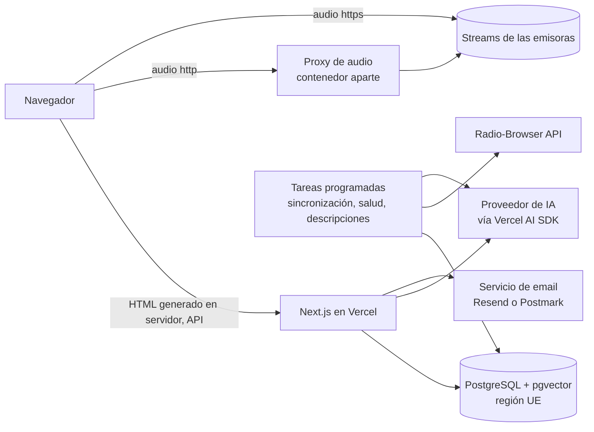

# DirectoRadio — Diseño de la primera versión (v1)

Fecha: 2026-11-04
Origen: [descripcionProyecto.md](../../specs/descripcionProyecto.md) y sesión de brainstorming.

Las decisiones marcadas con **[propuesta]** las propuso el asistente y el responsable del proyecto no las ha discutido una a una. Se pueden cambiar sin romper el resto del diseño. Los extras propuestos ya están **confirmados para v1**: mini-reproductor fijo, emisoras similares, páginas por género y país, y recordar el email verificado.

---

## 1. Qué es y por qué

DirectoRadio.com es una web pública para descubrir y escuchar emisoras de radio de todo el mundo. Lo que la diferencia es un **buscador con IA**: el usuario escribe o dice lo que busca en lenguaje natural ("Búscame una emisora de Portugal que emita fado") y la web le devuelve emisoras.

La v1 está pensada para **público de España**, con la interfaz **solo en español**. El catálogo es **mundial**, porque la gracia es escuchar cualquier radio. Más adelante se ampliará a otros países hispanohablantes.

La captación de tráfico depende en gran medida de Google ("radio fado online", "escuchar Cadena SER"). Por eso las páginas se generan en el servidor y cada emisora tiene su propia dirección.

## 2. Alcance

### Incluido en v1
- Catálogo propio en base de datos, importado de Radio-Browser y otras fuentes y sincronizado periódicamente.
- Portada con un listado de emisoras ordenado por las más escuchadas.
- Buscador por campos: búsqueda por nombre y filtros por país, idioma y género (cambio del 2026-11-13: sin IA; ver [diseño del buscador por campos](2026-11-13-buscador-por-campos-design.md)).
- Ficha de cada emisora con sus datos y el reproductor del streaming.
- Valoración de 1 a 5 estrellas, que requiere un email verificado.
- Contador de reproducciones.
- Diseño adaptable a móvil, tablet y escritorio.
- Política de privacidad, aviso legal y texto de aceptación del voto.

### Fuera de v1 (fases posteriores)
- Transcripción del audio en directo al idioma que elija el usuario.
- Traducción simultánea del audio.
- Formulario para que emisoras o personal de la empresa den de alta emisoras.
- Panel de administración. En v1, la gestión la hace una persona técnica directamente en la base de datos.
- Registro de usuarios con contraseña.
- Otros países hispanohablantes y variantes regionales.

## 3. Objetivos, no-objetivos y anti-objetivos

**Objetivos**
- Que cualquiera encuentre y escuche una emisora en pocos segundos, describiéndola con sus propias palabras.
- Que las fichas de emisora posicionen en Google.
- Que el catálogo pueda crecer después con altas manuales sin rehacer el modelo de datos.

**No-objetivos en v1**
- Cuentas de usuario, favoritos o historial.
- Funciones de audio con IA (transcripción y traducción).
- Una herramienta de edición para personas no técnicas.

**Anti-objetivos (cosas que serían un fracaso aunque la web funcione)**
- Que el buscador devuelva una pantalla vacía. Siempre debe mostrar las emisoras más parecidas.
- Que la portada esté llena de emisoras caídas o que no suenan.
- Que las valoraciones se puedan inflar o hundir fácilmente.
- Que el proxy de audio sirva para descargar cualquier URL de internet (proxy abierto o SSRF).
- Que el coste de la IA se dispare por abuso del buscador.

## 4. Restricciones

- Lo desarrolla y mantiene un **equipo web**, no el equipo .NET de la empresa.
- **RGPD:** se guardan emails. Hace falta una política de privacidad, aceptar explícitamente al votar y poder borrar los datos de una persona. Los datos se alojan en la UE **[propuesta]**.
- Muchas emisoras emiten por `http`. Una web `https` no puede reproducirlas directamente, así que hace falta un proxy.
- Radio-Browser no tiene descripciones y usa etiquetas libres, no un catálogo cerrado de géneros.
- El reconocimiento de voz del navegador (Web Speech API) no está disponible en todos los navegadores, por ejemplo en Firefox.
- **Derechos de retransmisión:** el proxy de audio retransmite contenido protegido. La empresa **acepta ese riesgo** para v1.
- **Tráfico previsto:** unos **100 usuarios al día**. Basta con planes pequeños o gratuitos. No hace falta escalado automático en v1.
- **IA:** se usa la **API de OpenAI**, con la cuenta del responsable. Una suscripción a ChatGPT (Plus, Pro…) **no incluye acceso a la API**: hace falta una clave de API en platform.openai.com, con su propia facturación por uso. Conviene poner un límite de gasto mensual en esa cuenta.
- **Sin publicidad en v1. Analítica solo con consentimiento** (cambio del 2026-11-13, ver [diseño de analítica y consentimiento](2026-11-13-analitica-consentimiento-design.md)). Se usa Google Tag Manager con Consent Mode v2: todo está denegado hasta que el usuario pulsa «Aceptar» en un banner propio, que tiene «Aceptar» y «Rechazar» al mismo nivel. La política de cookies está en `/politica-de-cookies`. Las cookies técnicas (la sesión de reproducción, la elección de cookies y la cookie firmada del email verificado) no necesitan consentimiento, pero la política las menciona.
- **Textos legales:** los redacta el equipo de desarrollo como parte de v1. Son la política de privacidad, el aviso legal y el texto de aceptación del voto. Se recomienda que un abogado los revise antes de abrir las valoraciones.

## 5. Enfoques considerados

### 5.1 Stack tecnológico

| Opción | Descripción | Pros | Contras |
|---|---|---|---|
| A | Todo en .NET: Blazor (generación en servidor e islas interactivas) + ASP.NET Core | Un solo lenguaje, encaja con el equipo .NET de la empresa, bien para Google | Ecosistema de componentes web más pequeño; no lo mantiene el equipo .NET |
| B | API en .NET + frontend en Next.js | El mejor frontend y bien para Google | Dos lenguajes y dos despliegues |
| **C (elegida)** | **Todo en TypeScript con Next.js** (web y lógica de servidor), PostgreSQL + pgvector, Vercel AI SDK | Un solo lenguaje, el ecosistema más maduro para webs que deben posicionar y para integrar IA, fácil de contratar | El proxy de audio y las tareas largas no caben en las funciones serverless; necesitan un servicio aparte |

Se descartó un backend en Python, porque no se entrenan modelos propios, solo se llaman servicios de IA. También se descartaron SvelteKit y Nuxt, que son técnicamente equivalentes pero tienen menos ecosistema.

**Elegida C** porque el proyecto lo desarrolla un equipo web distinto del equipo .NET.

### 5.2 Origen del catálogo

| Opción | Descripción |
|---|---|
| Consultar Radio-Browser en directo | Sin base de datos propia. Descartada: no permite guardar tus campos (estado, valoraciones, reproducciones) ni las altas futuras desde formulario. |
| **Copia propia sincronizada (elegida)** | Se importa a nuestra base de datos y se sincroniza periódicamente. Nuestros campos son nuestros. |

## 6. Decisiones de producto

### 6.1 Datos de cada emisora
Campos de la especificación original:
- Nombre
- Descripción
- Logotipo
- URL del streaming
- URL de la web
- País de origen
- Tipo o género
- Idioma de emisión
- Fecha de alta
- Fecha de última modificación
- Status (Activa, Desactivada, Eliminada)
- Número de reproducciones
- Valoración media
- Número de valoraciones

Se añaden:
- **Tags**: las etiquetas de Radio-Browser, normalizadas (en minúsculas, sin espacios sobrantes, sin duplicados). Se guardan en una tabla aparte, en relación de muchos a muchos. Sirven para la búsqueda y para asignar el género.
- **Género**: es una lista cerrada: Pop, Electrónica, Rock, Jazz, Clásica, Variada, Noticias, Deportes y Generalista, de la especificación original, más Religiosa, Latina, Country y folk, y Hip hop, añadidos el 2026-11-13 ([diseño del buscador por campos](2026-11-13-buscador-por-campos-design.md)). Se asigna desde los tags mediante una **tabla de correspondencias tag → género** que se mantiene en la base de datos. Cada emisora tiene **un género principal [propuesta]**; el detalle (por ejemplo "fado") queda en los tags. Si ningún tag tiene correspondencia, el género es "Variada" **[propuesta]**.
- **Origen y referencia externa**: la fuente (radio-browser, manual…) y el identificador en esa fuente (el `stationuuid` en el caso de Radio-Browser), para poder sincronizar.
- **Descripción generada**: un indicador de que la descripción la escribió la IA, para poder revisarla después.
- **Salud del stream [propuesta]**: fecha de la última comprobación, si funcionó y número de fallos seguidos. Es un dato distinto de `Status`: `Status` es una decisión editorial, la salud es automática.
- **Contador de clics de Radio-Browser**: se usa solo para ordenar la portada mientras no haya datos propios.
- **Slug**: el texto de la dirección de la ficha, único, por ejemplo `/emisora/cadena-ser`.

### 6.2 Sincronización del catálogo
- Una tarea programada importa o actualiza las emisoras desde Radio-Browser, por defecto una vez al día **[propuesta]**.
- La estructura admite "otras fuentes", pero en v1 solo se implementa Radio-Browser.
- Las emisoras nuevas entran con `Status = Activa`.
- **Si alguien ha editado a mano un campo** (descripción, logotipo o género), la sincronización no lo sobrescribe **[propuesta]**.
- Las emisoras que desaparecen de Radio-Browser no se borran: pasan a `Desactivada` **[propuesta]**.
- Radio-Browser repite emisoras. El tratamiento de los duplicados lo decide el builder (sección 9).

### 6.3 Comprobación de emisoras caídas
- Una tarea programada comprueba periódicamente si cada stream responde.
- Tras varios fallos seguidos, la emisora se oculta de la portada y de los resultados, pero su ficha sigue accesible y avisa de que puede no estar emitiendo **[propuesta]**. Cuando la emisora vuelve a responder, se muestra otra vez de forma automática.
- Las emisoras con `Status` Desactivada o Eliminada no aparecen en ningún listado. Las eliminadas devuelven un 404 o 410.

### 6.4 Portada
- **Cuadrícula de tarjetas** (opción A del boceto). Cada tarjeta muestra logotipo, nombre, bandera y país, género y estrellas.
- Arriba está el buscador con IA, con botón de micrófono.
- **Orden: las más escuchadas.**
  - **Mientras no haya datos propios:** primero las emisoras **españolas** ordenadas por el contador de clics de Radio-Browser, y después el resto del mundo con el mismo criterio.
  - **Con datos propios:** se usan las reproducciones de DirectoRadio de los **últimos 30 días** **[propuesta]**. El paso del ranking de Radio-Browser al propio es progresivo (sección 9).
- Solo aparecen emisoras activas y que funcionan.

### 6.5 Buscador con IA

> **Sustituido el 2026-11-13** por un buscador por campos sin IA: [diseño del buscador por campos](2026-11-13-buscador-por-campos-design.md). Lo que sigue queda como referencia para una fase posterior.
- **Entrada:** texto libre o voz.
- **Cómo funciona:**
  1. Un modelo de lenguaje convierte la frase en filtros estructurados (país, idioma, género, tags y, si existe el dato, ciudad o región) más un texto de intención.
  2. Se buscan emisoras que cumplan los filtros y se ordenan por **parecido de significado**, usando embeddings sobre nombre, descripción, tags, género y país.
  3. **Si no hay resultados exactos**, se van relajando filtros y se muestran "las más parecidas" con un aviso. **Nunca se muestra una pantalla vacía.**
- **Interfaz** (boceto aprobado):
  - Debajo de la caja aparece "He entendido:" con los filtros como etiquetas que se pueden quitar con la ✕. Al quitar una se repite la búsqueda sin volver a llamar al modelo **[propuesta]**.
  - Los resultados usan la misma cuadrícula que la portada, ordenados por relevancia.
- **Voz:**
  - Se usa el reconocimiento de voz del navegador en español de España (`es-ES`).
  - Si el navegador no lo tiene, se graba el audio y se transcribe en el servidor (Whisper o equivalente).
  - Mientras escucha, el botón se pone rojo y muestra "Escuchando…". El texto aparece en la caja mientras el usuario habla, y la búsqueda se lanza sola cuando deja de hablar.
- **Límites:**
  - Límite de búsquedas por IP para controlar el coste.
  - Caché de búsquedas frecuentes **[propuesta]**.
- **Idioma de las búsquedas:** se aceptan frases en español. Que entienda otros idiomas no es un requisito, pero tampoco hace falta impedirlo.

### 6.6 Ficha de la emisora
Boceto aprobado. Muestra:
- logotipo, nombre, país, género, idioma y tags
- valoración media, número de valoraciones y número de reproducciones
- botón **Escuchar en directo** y enlace a la web oficial
- descripción
- bloque de valoración
- **Emisoras similares**: sin IA, por género, tags compartidos, país e idioma ([diseño del buscador por campos](2026-11-13-buscador-por-campos-design.md), §5.6)

### 6.7 Reproductor
- **Mini-reproductor fijo en la parte inferior** de todas las páginas **[propuesta, mostrado en el boceto]**. La radio sigue sonando al navegar entre la portada, los resultados y otras fichas. Hace falta que la navegación del lado del cliente no reinicie el audio.
- Admite streams MP3, AAC, OGG y HLS (con `hls.js` donde el navegador no lo soporte de serie).
- Los streams `http` pasan por el **proxy de audio** (sección 7). Los `https` se reproducen directamente.
- **Contador de reproducciones:** sube cuando la reproducción empieza de verdad, no al abrir la ficha. Cuenta como máximo una vez por emisora y sesión del navegador **[propuesta]**.

### 6.8 Valoraciones
- **Flujo en dos pasos** (boceto aprobado):
  1. Solo se ven las estrellas.
  2. Al pulsar una, aparecen el campo de email, la casilla "Acepto la política de privacidad" y el botón **Enviar valoración**.
- Al enviar, el voto se guarda como **pendiente** y se manda un email con un enlace de verificación. El enlace **caduca a las 24 horas** **[propuesta]**.
- El voto **solo cuenta cuando el email está verificado**. Después se recalculan la media y el número de valoraciones.
- **Un voto por email y emisora.** Si vuelve a votar, el nuevo voto sustituye al anterior **[propuesta]**.
- **Emails ya verificados [propuesta]:**
  - Al verificar, el navegador guarda una cookie firmada que asocia ese navegador con el email.
  - Si el mismo navegador vota otra emisora con ese email, el voto cuenta directamente y el campo aparece ya relleno.
  - Si alguien escribe un email verificado desde otro navegador, se le pide verificar otra vez. Así nadie puede votar con el email de otra persona.
- **Protección contra abuso:**
  - límite de envíos por IP y por email
  - CAPTCHA invisible (Cloudflare Turnstile o similar) en el formulario **[propuesta]**
- **RGPD:**
  - política de privacidad enlazada
  - la aceptación se guarda con fecha
  - borrado de los datos de un email a petición, hecho a mano por la persona técnica en v1

### 6.9 Descripciones generadas con IA

> **Aplazado el 2026-11-13**: por ahora la web no usa servicios de IA y la ficha no muestra descripción ([diseño del buscador por campos](2026-11-13-buscador-por-campos-design.md)).
- Se generan **para todo el catálogo**, a partir del nombre, el país, el idioma, los tags y el género.
- Opcionalmente se usa la meta descripción de la web de la emisora, si se puede obtener **[propuesta]**.
- Están escritas en español, son breves y **no deben inventar datos concretos** (frecuencias, presentadores, horarios).
- Se marcan como generadas.
- Se generan al dar de alta la emisora y cuando cambian sus datos de forma relevante. Un cambio de URL del stream no cuenta como relevante.

### 6.10 Direcciones e idioma
- **Ficha:** `/emisora/{slug}`.
- Sin prefijo de país ni de idioma en v1. Cuando se amplíe a otros países se añadirán variantes sin romper las direcciones actuales.
- Los textos de la interfaz están en archivos de traducción desde el principio, aunque solo exista `es-ES`.
- **Páginas de listado por género y por país** (`/genero/{slug}`, `/pais/{slug}`) **[propuesta]**: ayudan a posicionar en Google. Se pueden quitar si se quiere reducir alcance.
- Datos estructurados (schema.org `RadioStation`), sitemap y metadatos Open Graph en las fichas.
- **Indexación selectiva [propuesta]:** se generan descripciones para todo el catálogo, pero solo entran en el sitemap y se dejan indexar en Google las fichas de emisoras activas, con stream sano, con logotipo y con un mínimo de popularidad. El resto lleva `noindex` hasta que cumpla esas condiciones. Así se evita que Google trate miles de fichas casi vacías como contenido de poca calidad. El umbral de popularidad lo fija el builder.

## 7. Arquitectura

| Pieza | Tecnología | Notas |
|---|---|---|
| Web y lógica de servidor | Next.js (App Router) + TypeScript | Generación en servidor y regeneración periódica de fichas y listados |
| Base de datos | PostgreSQL + `pgvector` (Neon o Supabase), región UE | Acceso desde el código con Drizzle o Prisma (a elegir por el builder) |
| IA | Vercel AI SDK con el proveedor **OpenAI** (API) | Se usa para entender búsquedas, generar embeddings y descripciones, y transcribir la voz como alternativa. El SDK permite cambiar de proveedor más adelante |
| Voz | Web Speech API, con Whisper en el servidor como alternativa | |
| Reproductor | `<audio>` + `hls.js` | Mini-reproductor persistente |
| Proxy de audio | Servicio aparte (Fly.io, Railway o Cloudflare Worker) | Las conexiones duran horas y no caben en serverless |
| Tareas programadas | Proceso Node en contenedor o planificador externo | 50.000 emisoras: no caben en los límites de tiempo de Vercel Cron |
| Email | Resend o Postmark | Verificación de votos |
| Anti-abuso | Límites por IP + Turnstile | |

**Seguridad del proxy de audio (obligatorio):**
- Recibe **el identificador de la emisora**, nunca una URL. Busca la URL del stream en nuestra base de datos.
- Rechaza IPs privadas o locales tras resolver el dominio (protección contra SSRF).
- Solo deja pasar respuestas de audio, con un límite de conexiones simultáneas por IP.

**Preparación para fases futuras [propuesta]:** en v1, el proxy solo atiende streams `http`. Se diseña como un servicio independiente para que más adelante pueda recibir todos los streams y alimentar la transcripción y la traducción. No se construye nada de eso en v1.

**Región UE [propuesta]:** las funciones de Vercel se configuran en una región de la UE, la base de datos también va en la UE, y el proveedor de email se elige con almacenamiento en la UE, si está disponible.

## 8. Modelo de datos (orientativo)

- `emisora`: id, slug, nombre, descripción, descripción generada (sí/no), URL del logo, URL del stream, URL de la web, código de país, idioma(s), género principal, status, fuente, id externo, contador de clics de Radio-Browser, reproducciones totales, valoración media, número de valoraciones, campos de salud del stream, campos protegidos por edición manual, embedding, fecha de alta y fecha de última modificación.
- `tag` y `emisora_tag`.
- `tag_genero`: correspondencia de cada tag con un género.
- `reproduccion`: emisora, fecha, identificador anónimo de sesión. Sirve para el ranking de 30 días; se puede agregar por día.
- `email_verificado`: email, fecha de verificación, fecha de aceptación de privacidad.
- `valoracion`: emisora, email, estrellas, estado (pendiente o verificada), token y su caducidad, fechas. Único por emisora y email.

## 9. Lo que queda en manos del builder

- El orden de implementación y el plan de entregas.
- La fórmula exacta para pasar del ranking de Radio-Browser al propio: umbral, pesos y si se calcula por emisora o de forma global.
- Cómo detectar duplicados de Radio-Browser (misma URL de stream, nombre parecido…).
- El contenido inicial de la tabla tag → género. Se puede generar con IA y revisarlo a mano.
- Cada cuánto se comprueba la salud de los streams, cuántos fallos seguidos ocultan una emisora y el tiempo máximo de espera.
- La elección concreta de Drizzle o Prisma, de Neon o Supabase, del modelo de IA y del alojamiento del proxy y las tareas.
- Paginación o scroll infinito en la portada y en los resultados.
- Si los datos de país, región o ciudad de Radio-Browser permiten filtrar por ciudad.
- El diseño visual: colores, tipografía y logotipo. Los bocetos solo fijan la estructura.
- Los límites concretos de búsquedas y votos por IP, y el tiempo de vida de la caché.
